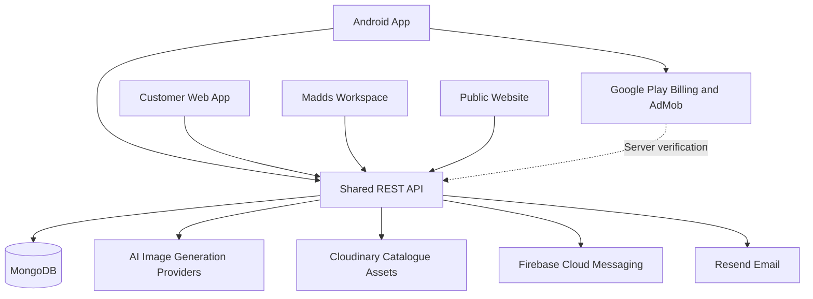

<div align="center">


# Madds — AI Photo Studio

**Turn everyday photos into extraordinary AI creations.**

[](App/)
[](Backend/)
[](Backend/)
[](https://github.com/itsdhruvbhardwaj/Madds/tree/codex/webapp-production/WebApp)

[Google Play](https://play.google.com/store/apps/details?id=com.itsdhruvbhardwaj.picme) · [Website](https://maddsofficial.com) · [Web App](https://app.maddsofficial.com)

</div>

## About Madds

Madds is an AI-powered photo studio that makes creative image editing accessible without requiring design experience or prompt engineering. Users choose a curated style, upload a reference photo, and generate a personalized image directly from the app. A shared credit system and optional rewarded ads support an accessible generation experience.

The project combines a native Android application, a shared AI generation backend, a team-operated content management Workspace, a public website, and an installable customer web app for iPhone and other browsers.

## Features

### Photo creation and discovery

- Curated AI styles, trending looks, themed collections, and personalized discovery.
- Search by style name, collection, and tags; browse related variations within style groups.
- Interactive before-and-after previews, favorites, and account-synced style preferences.
- AI-powered image transformations through configurable generation models.
- Background generation with ready alerts, a 24-hour temporary gallery, and full-screen previews.
- Download generated photos to the device and revisit saved creations independently of temporary server results.

### Accounts and engagement

- Email/password and Google sign-in, profile personalization, and account management.
- Credits, daily rewards, welcome bonuses, rewarded ads, and Android Google Play Billing support.
- Push notifications, generation recovery, and in-app feedback.
- Configurable banner, native, interstitial, and rewarded ad placements on Android.

### Madds Workspace

- Restricted team access to manage styles, collections, tags, groups, and Home sections.
- Reusable original-image library with categorized folders, uploads, downloads, and linked cover/after previews.
- Prompt testing, model configuration, image optimization, and asset management.
- User management, feedback, style performance, notification campaigns, and scheduled reminders.
- Server-controlled credit rewards, advertising settings, and audited configuration changes.
- Installable, online-first interface for approved team members.

## System architecture



The backend owns generation requests, authentication, credit accounting, catalogue data, and provider configuration. Clients use the shared API so catalogue and business settings can be updated centrally without requiring an Android release for every content change.

## Repository structure

| Directory | Purpose | Technology |
|---|---|---|
| [`App/`](App/) | Native Android client | Kotlin, Jetpack Compose, Material 3 |
| [`Backend/`](Backend/) | REST API and AI generation services | Node.js, Express, TypeScript, MongoDB, Mongoose |
| [`Admin-Portal/`](Admin-Portal/) | Madds Workspace | HTML, CSS, JavaScript, PWA |
| [`Frontend/`](Frontend/) | Public website and support pages | HTML, CSS, JavaScript |
| [`WebApp/`](https://github.com/itsdhruvbhardwaj/Madds/tree/codex/webapp-production/WebApp) | Customer-facing web app | React, TypeScript, Vite, TanStack Query, PWA |
| [`docs/`](docs/) | Feature design, rollout, and integration notes | Markdown |

The main repository branch is `main`. The customer web app is currently maintained and deployed from `codex/webapp-production`.

## Technology stack

| Layer | Tools and services |
|---|---|
| Android | Kotlin, MVVM, Jetpack Compose, Navigation Compose, Retrofit, Coil, AndroidX Credentials |
| Web | React, TypeScript, Vite, React Router, TanStack Query, HTML/CSS/JavaScript |
| API | Node.js, Express, TypeScript, JWT, Mongoose |
| AI | OpenRouter and OpenAI provider integrations; Workspace-controlled Sunburst model profiles |
| Data and media | MongoDB, Cloudinary, Sharp, client-side image compression |
| Integrations | Firebase Cloud Messaging, Google Sign-In, Resend, Google Play Billing, AdMob |
| Testing | JUnit, Mockito, Compose UI testing, Vitest, Supertest, Node.js test runner |
| Hosting | Render, HTTPS custom domains, GitHub-based deployments |

## Local development

Clone the repository:

```bash
git clone https://github.com/itsdhruvbhardwaj/Madds.git
cd Madds
```

### Backend

Use Node.js 22 or newer and a separate development MongoDB database. Copy `Backend/.env.example` to `Backend/.env` and configure the required database, authentication, and generation provider settings. Optional integrations require their corresponding service accounts. Never commit real credentials.

```bash
cd Backend
npm ci
npm run dev
```

Run `npm run build` to compile the TypeScript server and `npm test` to run the backend test suite. The API exposes a `/health` endpoint for readiness checks.

### Android

Open `App/` in Android Studio, install the required Android SDK (compile SDK 37), use the configured JDK 21 Gradle toolchain, and add the project's local Firebase configuration. Configure the backend endpoint for your development environment and use authorized ad test devices or test ad units during development.

```powershell
cd App
.\gradlew.bat assembleDebug
.\gradlew.bat testDebugUnitTest
```

### Workspace and public website

The Workspace includes a local fixture server that does not require production credentials or send real notifications:

```bash
node Admin-Portal/tests/preview-server.cjs
```

Open `http://127.0.0.1:4178`. For Workspace integration setup, see the [Admin Portal guide](Admin-Portal/README.md).

To preview the public website from the repository root:

```bash
python -m http.server 8080 --directory Frontend
```

Open `http://localhost:8080`. See the [website guide](Frontend/README.md) for configuration.

### Customer web app

The web app uses Node.js 22.12 or newer. To work on it separately:

```bash
git clone --branch codex/webapp-production https://github.com/itsdhruvbhardwaj/Madds.git Madds-Web
cd Madds-Web/WebApp
npm ci
npm run dev
```

Open `http://127.0.0.1:5174`. The web app is a progressive web app (PWA), supporting browser use and installation to the iPhone Home Screen. It is not a native iOS binary. See its [development guide](https://github.com/itsdhruvbhardwaj/Madds/blob/codex/webapp-production/WebApp/README.md).

## Privacy and reliability

- Account-scoped access to private generations and temporary results.
- Temporary generated photos expire after 24 hours; device-saved copies are separate.
- Server-side credit accounting, purchase verification, and rewarded-ad callback verification.
- Authorized Workspace access, protected server configuration, and audit records.
- Image compression, CDN delivery for catalogue assets, pagination, client caching, and generation recovery.
- Provider keys, database credentials, account secrets, signing material, and production configuration must remain outside source control.

## Documentation

- [Temporary generations](docs/temporary-generations.md)
- [Style groups](docs/style-groups.md) and [search tags](docs/style-tags.md)
- [AI model configuration](docs/sunburst-model-switch.md)
- [Daily rewards](docs/daily-rewards.md) and [automated reminders](docs/daily-reminders.md)
- [Ad placement controls](docs/ad-placement-controls.md) and [rewarded credits](docs/rewarded-credit-settings.md)
- [Push notifications](docs/push-notifications.md)
- [Storage cleanup](docs/storage-cleanup.md)
- [Workspace documentation](Admin-Portal/README.md)

## Project links and support

- **Android:** [Madds on Google Play](https://play.google.com/store/apps/details?id=com.itsdhruvbhardwaj.picme)
- **Website:** [maddsofficial.com](https://maddsofficial.com)
- **Web App:** [app.maddsofficial.com](https://app.maddsofficial.com)
- **Privacy:** [Privacy Policy](https://maddsofficial.com/privacy.html)
- **Support:** [Help & Support](https://maddsofficial.com/help.html) · [madds.support@gmail.com](mailto:madds.support@gmail.com)

---

<div align="center">
Built with care by the Madds team.
</div>
